 <div align="center">


<br/>


</div>

---

## `01 // TERMINAL INTRO`

```bash
┌──(arham㉿cyberlab)-[~]
└─$ whoami

[+] Name       : Arham
[+] Username   : arham1470
[+] Role       : Software Developer
[+] Interest   : Cybersecurity & Ethical Hacking
[+] Hobby      : Online Gaming
[+] Focus      : Web Development & Security
[+] Status     : Always Learning

└─$ echo "Welcome to my digital world!"
```

## `02 // ABOUT ME`

Hey! I'm **Arham**, a software developer and technology enthusiast interested in exploring how the digital world works.

- 💻 Building modern web applications.
- 🔐 Exploring cybersecurity and ethical hacking.
- 🛡️ Learning penetration testing and security tools.
- 🤖 Interested in AI-powered cybersecurity.
- 🐧 Exploring Linux and open-source technologies.
- 🎮 Online gaming enthusiast.

**My philosophy:** Understand how systems work, discover how they can fail, and learn how to make them more secure.

## `03 // CYBERSECURITY TOOLKIT`

<div align="center">

### SECURITY & PENETRATION TESTING


### DEVELOPMENT


### ENVIRONMENT & TOOLS


</div>

## `04 // GITHUB STATISTICS`

<div align="center">

<picture>
  <source media="(prefers-color-scheme: dark)" srcset="./assets/overview.dark.svg" />
  
</picture>

<br/>

<picture>
  <source media="(prefers-color-scheme: dark)" srcset="./assets/languages.dark.svg" />
  
</picture>

</div>

## `05 // CONTRIBUTION ACTIVITY`

<div align="center">

<picture>
  <source media="(prefers-color-scheme: dark)" srcset="./assets/contributions.dark.svg" />
  
</picture>

<br/>

<picture>
  <source media="(prefers-color-scheme: dark)" srcset="./assets/lifetime.dark.svg" />
  
</picture>

</div>

## `06 // CONTRIBUTION SNAKE`

<div align="center">


</div>

## `07 // FEATURED PROJECTS`

<div align="center">

<a href="https://github.com/arham1470?tab=repositories">

</a>

</div>

I'm continuously working on development projects, exploring open-source security tools and experimenting with new technologies.

## `08 // CONNECT WITH ME`

<div align="center">

<a href="https://github.com/arham1470">

</a>

</div>

---

<div align="center">

```text
╔══════════════════════════════════════════╗
║             SYSTEM MESSAGE               ║
╠══════════════════════════════════════════╣
║  ACCESS GRANTED                          ║
║  THINK LIKE A DEVELOPER                  ║
║  LEARN LIKE A HACKER                     ║
║  BUILD LIKE AN ENGINEER                  ║
║  SECURE THE DIGITAL WORLD                ║
╚══════════════════════════════════════════╝
```


**`END OF TRANSMISSION // ARHAM1470`**

</div>